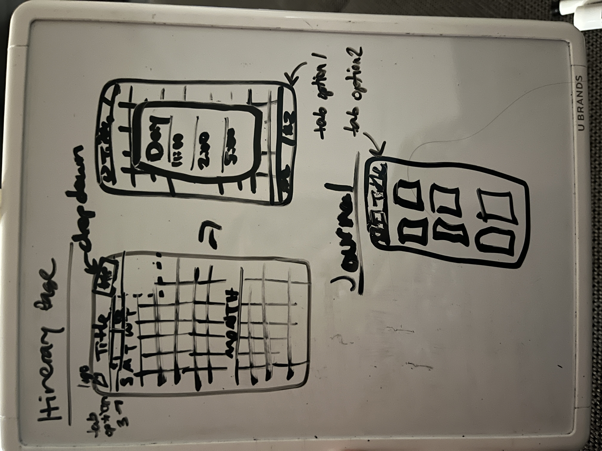

# CSE 310 - Sprint Time Log

Name: Luce DeWitt

Sprint #: 2

## Instructions

Record all CSE 310 work that you do either inside class or outside of class.  Include time learning, practicing, developing, testing, and documenting.  It is important to update this log every day.

For the Category column, record one of the following:
* IM - You are working on your Individual Module (Don't include Planning Meeting in class)
* TP - You are working on your Team Project (include Team Project Work Days)
* MTG - You are in one of the following class meetings: Planning, Stand-Up, Team Review, or Individual Review

The expected minimum amount of time each Sprint for each category is as follows:

|Categroy                       |Total Time (Hours:Minutes)|
|-------------------------------|:------------------------:|
|IM - Individual Module         |          10:00           |
|TP - Team Project              |           4:00           |
|MTG - Class Meetings           |           4:00           |
|**TOTAL**                      |        **18:00**         |

## Time Log

|Date      |Start Time|Category|Description                                 |Total Minutes|
|----------|----------|:------:|--------------------------------------------|:-----------:|
| 10/5/26  | 10:27    |MTG & IM| Planning Meeting                           | 38/48       |
| 10/5/26  | 8:33     |   IM   | Planning and designing                     | 21          |
| 10/6/26  | 4:19     |   IM   | Designing the app icon                     | 67          |
| 10/7/26  | 10:20    |   TP   | Worked on screen mirroring, windows/tabs   | 63          |
| 10/7/26  | 6:46     |   IM   | Remade app icon, set up, readme            | 70          |
| 10/8/26  | 5:33     |   IM   | Set the app icon, planned                  | 27          |
| 10/8/26  | 9:16     |   IM   | Planning and sketching                     | 36          |
| 10/9/26  | 10:15    |MTG & TP| Stand up-meeting, discussion, log-in page  | 6/57        |
| 10/9/26  | 10:46    |   IM   | Dicussed personal projects                 | 8           |
| 10/9/26  | 4:43     |   IM   | App header, learning                       | 68          |
| 10/12/26 | 10:19    |   TP   | Finished/worked on login and Accounts pages| 62          |
| 10/12/26 | 5:14     |   IM   | Fixed Expo and nmp stuff, added calendar   | 63          |
| 10/13/26 | 4:19     |   TP   | Created and worked on team presentation    | 15          |
| 10/13/26 | 5:12     |   IM   | Calendar colors, trip dropdown             | 61          |
| 10/14/26 | 10:16    |MTG & TP| Team presentations                         | 60          |
| 10/14/26 | 7:38     |   IM   | Tabs styling, journal page, journal icon   | 79          |
| 10/15/26 | 5:04     |   IM   | Fixed adding trips, created memory, delete icon, edit note feature, add comments, finishing details   | 66          |
| 10/16/26 | 10:17    |   MTG  | Personal presentations                     | 65          |
|          |          |        |                                            |             |

_Note: Add more rows as needed._

## Sprint Totals

|Categroy                       |Total Time (Hours:Minutes)|
|-------------------------------|:------------------------:|
|IM - Individual Module         | 10h 14m                  |
|TP - Team Project              | 4h 21m                   |
|MTG - Class Meetings           | 2h 49m                   |
|**TOTAL**                      |                          |

 
 
 
 
 

## Project Notes (Ignore)
Color scheme: https://coolors.co/41b8aa-194454-595054-995c54-da6555-ec9e4c 

Icon:

Plan:
- Idea: Build a travel planning app that helps users organize their trips, including itinerary creation and travel tips.?
- Pages: journal, history?, itinerary (calandar), home?
- Needed functions/buttons: create new trip, choose trip (drop down), calandar with times (itinerary), expanded day? (times & notes?), delete trip {page 1?}
- Extra needed functions/buttons: add journal/note, add picture?, store trip? {page 2}
- How would the journals be stored? Would it just be notes? Maybe you could have multiple journals and there are enteries inside it? Or would it be on a calandar again? It could be another drop down. But having like, little books/journals could look cool.
- Extra: travel journal (could just be a history of trips, or a journaling app)
- How do you enter the itinerary? Where is that button? Is it with the add plan/edit plan? Or is there a way to edit the day's info? I think I prefer the day's info. Where would the add trip button be? Probably at the bottom/top of the dropdown.
- How to go between the pages? Menu on the bottom? On the top next to the Title? Underneath the title? I don't know if I like any options yet. They all feel too claustrophobic. Eh, I'll just use the default bottom menu.

Requirements:
- The app should have at least one screen ✓
- Provide at least 1 input from the user (e.g. tap, double-tap, swipe) ✓
- The display should change after the input from the user ✓
- Display a picture ✓
- Provide a custom icon for the app on the phone ✓

Stretch:
- Incorporate two or more screens ✓

Extra/If I had more time ideas:
- Connect to/send out reminders?
- Travel tips

Basic sketch of screens:

Todo:
- Edit colors on calendar (current day, arrows, do current colors look good?) ✓
- Add drop down to calendar with add trip option ✓
- Add travel journal page ✓
- Add memory/persistence? ✓
- Add events notes? On the scroll thing?
- When adding a new Trip, let user add events?
- Add comments ✓